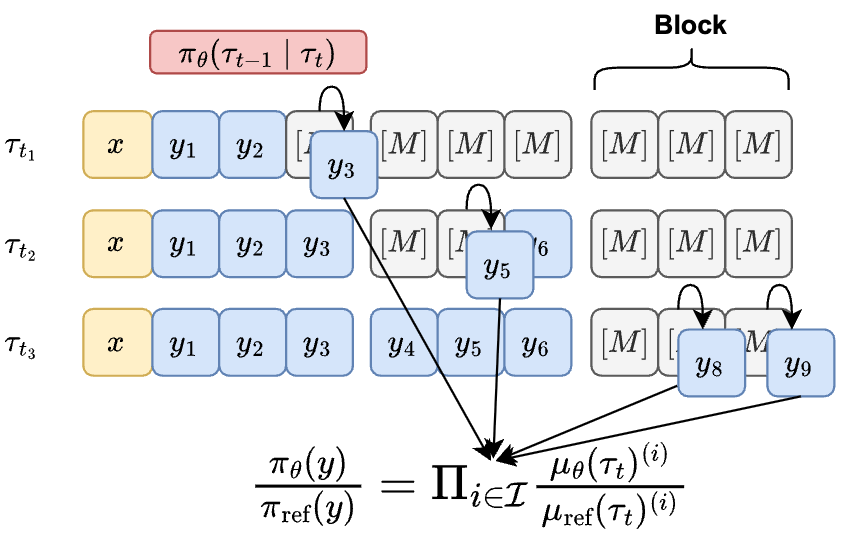
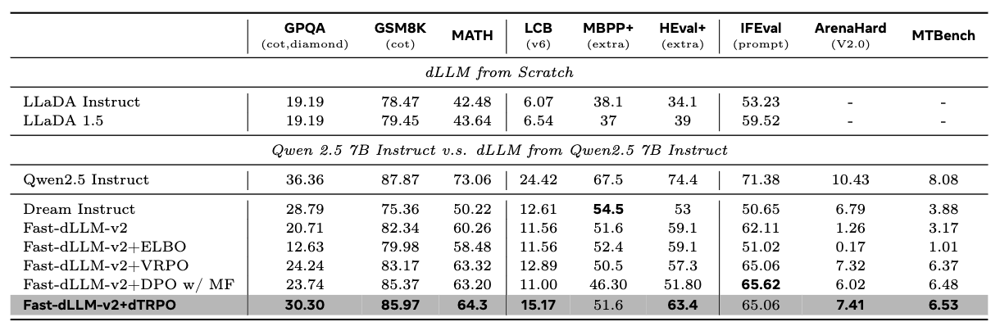
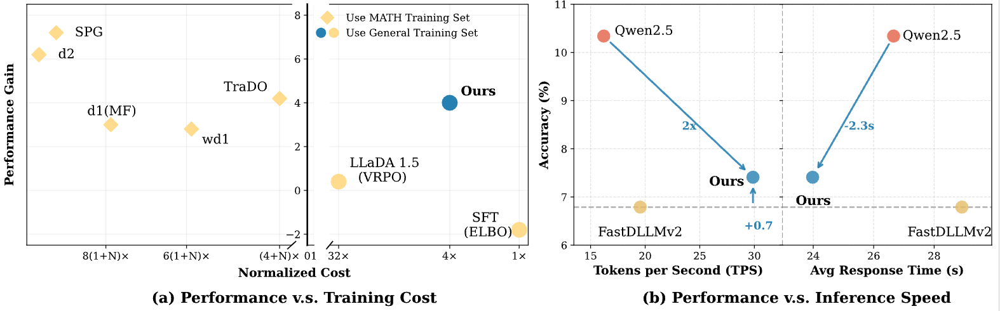

# dTRPO: Trajectory Reduction in Policy Optimization of Diffusion Large Language Models

[](https://arxiv.org/abs/TODO)
[](https://huggingface.co/TODO)

dTRPO designs two-stage trajectory reduction techniques to enable efficient policy optimization of diffusion large language models (dLLMs):

 This repo provides the training code, scripts, and configs to reproduce our results on Fast-dLLM and LLaDA.

## 📰 News

- **[2025/03]** Training code released.
- **[2025/03]** Paper available on [arXiv](https://arxiv.org/abs/TODO).

## 🔬 Method Overview

<p align="center">
  
</p>

**Stage 1: One-sample MC estimation.** Sample one state $\tau_t$ per block to estimate the sequence probability.

**Stage 2: Intermediate-state reduction.** Under reference policy regularization, the full sequence probability ratio decomposes into a product over only the newly unmasked tokens at each diffusion step:

The final dTRPO loss is:

$$\mathcal{L}_{\text{dTRPO}}(\theta) = - \mathbb{E}_{(\mathbf{y}^+, \mathbf{y}^-) \sim \mathcal{D}} \log \sigma \Bigg( \lambda \, T_B \bigg[ S(\mathbf{y}^+_{s,t};\theta, \text{ref}) - S(\mathbf{y}^-_{s,t};\theta, \text{ref}) \bigg] \Bigg)$$

where $T_B$ is the number of blocks, $\lambda$ is the regularization coefficient, and $S$ is the summation of log-probability ratio.

## 🚀 Performance
### Benchmark Performance
<p align="center">
  
</p>

**dTRPO** achieves the best overall performance among all dLLM methods, outperforming VRPO, ELBO, and DPO w/ MF baselines across reasoning, code, and instruction-following benchmarks.

### Efficiency Analysis
<p align="center">
  
</p>

**dTRPO** significantly reduces the training cost and produces a high quality model that has high TPS and low response time. 

## 🏋️ Installation

**Requirements:** Python >= 3.10, CUDA-compatible GPU (A100 80GB recommended)

```bash
pip install torch torchvision \
    transformers trl peft accelerate \
    datasets liger-kernel \
    numpy pandas einops wandb tensorboard pyyaml tqdm
```

## 🎮 Quick Start

### Fast-dLLM dTRPO

```bash
torchrun --nproc_per_node=4 --master_port=29502 -m train \
  --model_name_or_path Efficient-Large-Model/Fast_dLLM_v2_1.5B \
  --model_type fastdllm \
  --dataset_mixture_yaml configs/smoltalk2_dpo.yaml \
  --output_dir ./output/fastdllm_dtrpo \
  --dtype bfloat16 --bf16 True \
  --learning_rate 1e-7 \
  --per_device_train_batch_size 2 \
  --gradient_accumulation_steps 8 \
  --beta 0.05 \
  --loss_type sigmoid \
  --logp_type dtrpo \
  --mc_samples 1 \
  --block_size 32 \
  --max_length 2048 \
  --trust_remote_code True \
  --report_to wandb \
  --fsdp "full_shard auto_wrap"
```

Or simply: `bash scripts/fastdllm.sh`


## 📊 Key Arguments

| Argument | Description | Default |
|----------|-------------|---------|
| `--model_type` | Model architecture: `fastdllm` or `llada` | required |
| `--logp_type` | Log-prob estimator: `dtrpo` (ours) or `vrpo` | `dtrpo` |
| `--mc_samples` | Number of MC masking samples per batch | `1` |
| `--mc_batch_size` | MC samples per GPU forward pass | `1` |
| `--block_size` | Block size for block-wise scoring (Fast-dLLM-v2) | `32` |
| `--beta` | DPO KL penalty coefficient | `0.05` |
| `--loss_type` | DPO loss variant: `sigmoid`, `hinge`, `ipo`, etc. | `sigmoid` |
| `--cfg_scale` | Classifier-Free Guidance scale (LLaDA only) | `0.0` |
| `--mask_token_id` | Mask token ID | required |
| `--max_length` | Maximum sequence length (prompt + completion) | required |
| `--mlp_only` | Freeze all parameters except MLP layers (Fast-dLLM-v2) | `True` |

## 📦 Dataset Format

Training data requires three fields per example:

```json
{"prompt": "...", "chosen": "...", "rejected": "..."}
```

Configure dataset mixtures via YAML (see `configs/smoltalk2_dpo.yaml`):

```yaml
seed: 42
datasets:
  - id: HuggingFaceTB/smoltalk2
    config: Preference
    split: llama_3.1_tulu_3_8b_preference_mixture_no_think
    columns: [chosen, rejected, prompt, chat_template_kwargs]
    weight: 0.5
```

Pass via `--dataset_mixture_yaml`, or use `--dataset_name` for a single HuggingFace dataset.

## 📁 Project Structure

```
dllm_post_training/
├── train.py                          # Training entry point
├── trainer/
│   ├── dpo_base.py                   # DLDPOConfig, DLDPOTrainer, data collator
│   ├── dpo_llada_trainer.py          # LLaDA: random-masking MC forward step
│   ├── dpo_fast_dllm_trainer.py      # Fast-dLLM: shifted-label MC forward step
│   └── trl_compat.py                 # TRL compatibility utilities
├── model/
│   ├── modeling_fastdllm.py          # Fast-dLLM model definition
│   └── config_fastdllm.py            # Fast-dLLM configuration
├── data/
│   ├── data_mixture.py               # Dataset loading and mixture utilities
│   └── parsing_functions.py          # Dataset parsing helpers
├── configs/
│   └── smoltalk2_dpo.yaml            # Example dataset mixture config
└── scripts/
    ├── fastdllm.sh                   # Fast-dLLM launch script
    └── llada.sh                      # LLaDA launch script
```

## 📄 License

This project is licensed under the FAIR Noncommercial Research License. See the [LICENSE](LICENSE) file for details.

## 📚 Citation

If you find this work useful, please cite our paper:

```bibtex
@article{dtrpo2025,
  title={dTRPO: Trajectory Reduction in Policy Optimization of Diffusion Large Language Models},
  author={Wenxuan Zhang, Lemeng Wu, Ernie Chang, Mingchen Zhuge, Zechun Liu, Andy Su, Hanxian
Huang, Jun Chen, Chong Zhou, Raghuraman Krishnamoorthi, Vikas Chandra, Mohamed
Elhoseiny, Wei Wen},
  year={2025}
}
```

## 🙏 Acknowledgements

- [TRL](https://github.com/huggingface/trl) — Transformer Reinforcement Learning
- [Fast-dLLM](https://github.com/NVlabs/Fast-dLLM) — Block Diffusion Language Model
- [LLaDA](https://github.com/GSAI-ML/LLaDA) — Large Language Diffusion Model
